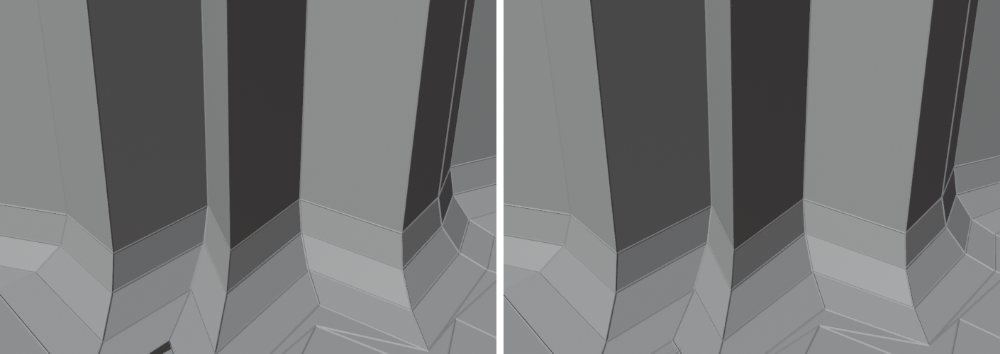
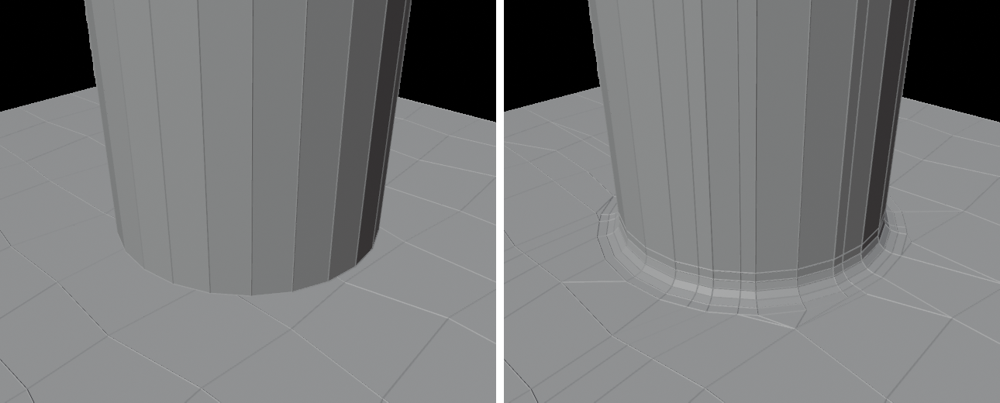
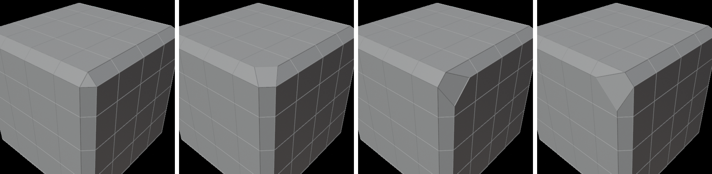

# HB_BevelFix for Blender

Fixes bevels that overlap / fold where the bevel width is bigger than a neighbouring
edge, by **edge-sliding only the affected vertices** to a smoothed value — unlike
*Clamp Overlap*, which shrinks the whole bevel.

*Left to right: overlapping bevel, Fix (slide), Fix with Weld Conflicts.*

## Install (Blender 4.2+)
Edit > Preferences > Get Extensions > ⌄ (top right) > **Install from Disk…** > `hb_bevelfix.zip`.

## Use
1. Bevel as usual (Ctrl+B). Leave *Clamp Overlap* off.
2. With the bevel's faces still selected, run **Fix Bevel Overlap**:
   **Ctrl+Alt+B**, or Edge menu (Ctrl+E), or the right-click menu.
3. Tweak in the redo panel (bottom-left):
   - **Max Slide** – furthest a fixed vertex may go along its edge (fraction of the edge)
   - **Tolerance** – how different a vertex's slide may be from its neighbours before it's fixed
   - **Blend** – also ease this many neighbouring vertices for a gradual transition
   - **Smooth Whole Bevel** – smooth every vertex's slide, not only the broken ones
   - **Weld Conflicts** (aggressive) – where an edge is too short for the bevel, the vertex at its
     far end is merged into the bevel vertex, so the bevel keeps its full, smooth width instead of
     being squeezed (the idea of MESHmachine's Boolean Cleanup, which merges the vertices on one
     side of a seam into the other; MESHmachine's Offset/Chamfer "Merge Perimeter" does the same)
   - **Merge Threshold** – collapse neighbouring bevel slices that ended up closer than this,
     removing sliver faces (MESHmachine's Boolean Cleanup merges loop vertices into their closest
     neighbour within a threshold). 0 = off
   - **Width** – widen or narrow the whole bevel afterwards by sliding along its edges (with the
     same clamping / welding), **Taper** ramps it along an open bevel, **Flip** reverses the ramp
     (MESHmachine's Change Width)

## Boolean Bevel
Select the boolean's intersection loop (edges), then either
- use the **Boolean Bevel** tool in the Edit Mode toolbar (next to Bevel): its settings are in the
  **Tool Settings** bar (Width, Segments, Shape, Fill, ⚙ for the rest); **drag** in the viewport to
  bevel — clicks still select; or
- Edge menu / right-click menu > **Boolean Bevel** (right-click it > *Assign Shortcut* or
  *Add to Quick Favorites* to put it on a key or the Q menu).

It's interactive like Ctrl+B: **move the mouse** to set the width (live preview, **Shift** for
precision), **mouse wheel** for segments, **click / Enter** to confirm, **right-click / Esc** to
cancel. It starts from the last used settings (Width 0 = a quarter of the loop's average edge, so it
fits the model's scale) and the redo panel stays available afterwards.

What it does — MESHmachine's chamfer workflow as one step:
1. **Boolean Cleanup** – loop vertices the boolean added mid-face are merged into their closest
   loop neighbour, closest first, **stopping automatically** once the remaining gaps are longer than
   *Merge Distance* (× width). *Keep Side* Auto keeps the side most loop vertices belong to.
2. **Offset** – a support loop on both sides (*Offset* × width away), straight across the surface
   (or along existing edges with *Loop Slide*): a clean strip of quads for the bevel.
3. **Offset cleanup** – old vertices left inside the strip or on a support loop are pushed just
   outside it, slivers along the loop are dissolved, faces that would fold are merged.
4. **Bevel**, then **Fix Bevel Overlap** on it.
5. **Fill N-gons** around it: *Quads* splits faces with extra vertices along one side straight
   across (the cut carries on for up to *Cut Reach* faces), then triangulates what's left and joins
   the triangles back into quads where the shapes allow; *Triangles*; or *Off*.

## Turn Corner
Edge menu / right-click menu > **Turn Corner**, with the corner face selected (where three
chamfers meet):
- a **triangle** corner (what Blender's 1-segment bevel makes) becomes a **quad corner** —
  *Corner* (0–2) picks which way the chamfers flow through it;
- a **quad corner** is **turned**: the chamfer that ended there now flows through, and another
  one ends instead. Run it again to keep turning.
- *Width* sets the width of the turned chamfer (0 = same as the existing one).

Same idea as MESHmachine's Turn Corner (split the corner's outer vertex along its two outward
edges, rebuild the faces around it, merge the two inner vertices where their edges meet), written
from scratch. Works on single-segment chamfers; multi-segment corner patches aren't handled.

## Select (Alt + click) — LSelect / SSelect / VSelect
Works like MESHmachine's Select: on Blender's loop-select key (**Alt + click**) it first looks at
what's already selected:
- **Edge mode**, isolated edges selected (edges not touching other selected edges): if any is smooth
  → **LSelect**, else (all sharp) → **SSelect**. The redo panel toggles *Loop / Sharp* and sets
  *Min Angle* (default 60; higher grows the loop).
- **Face mode**, exactly 2 neighbouring faces selected → the face loop through them.
- **Vertex mode**, the mesh has vertex groups and vertices are selected → **VSelect**: mouse wheel
  cycles the groups of the selection, **S** toggles one, **A** toggles all, click selects
  (with a single group it selects it right away).
- Otherwise the click goes through to **Blender's own loop select** as usual.

**LSelect** walks from each edge in both directions, always taking the next edge that continues
the current one most straightly, while the angle between them stays above 180° − *Min Angle* —
no quad topology needed. **SSelect** selects all sharp edges connected to the selection.
Preferences: *Select on Alt + Click* (on/off) and *Always Loop Select* (loop select even when only
sharp edges are selected). All four are also in Select > **HB Select**.

## How it works
The selected bevel is read as slices across the strip. For each slice the two edges the
outer vertices slid along are intersected to recover the original corner, giving every
outer vertex a *slide distance*. Vertices that slid past the end of their edge, or much
further than their neighbours, get the average of their neighbours' slides (healthy ones
stay put), clamped inside the edge. Where Blender left a vertex inside a face (no edge
back to the corner), it slides along that surface instead. The inner profile vertices are
re-mapped so the bevel keeps its shape.

Works on quad-strip bevels (any segment count). Slices it can't read (e.g. complex miter
patches at corners) are left untouched.
