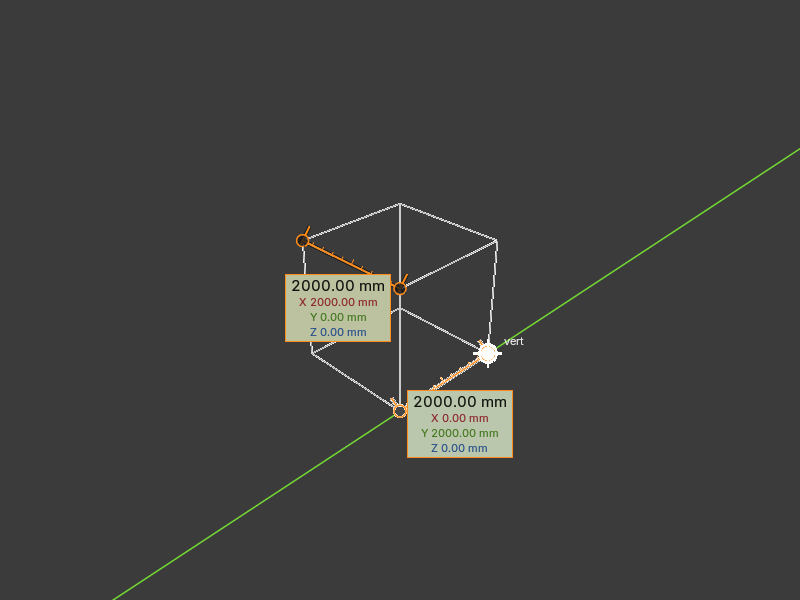

# Caliper Measure for Blender

Measurements that **stay visible in every mode** (Object, Edit, Pose, paint modes…),
with draggable handles, **Ctrl snapping** and **X/Y/Z axis locking**.

## Install (Blender 4.2+)
Edit > Preferences > Get Extensions > ⌄ (top right) > **Install from Disk…** > `caliper_measure.zip`.

## Use
Pick the **Caliper** tool in the 3D view toolbar (next to Measure), or go to Sidebar (N) > **Caliper** > *Caliper Tool*.

| Action | Result |
|---|---|
| Drag on empty space | New measurement |
| Drag a handle | Move that end |
| Drag the line | Move the whole measurement |
| Hold **Ctrl** while dragging | Snap to the nearest vertex / edge midpoint / face center / object origin / 3D cursor / other handle (falls back to the surface under the mouse) |
| **X / Y / Z** while dragging | Lock to that axis (press again to unlock). With Ctrl, the handle slides along the axis to line up with the snap target |
| **Shift+X/Y/Z** while dragging | Lock to the plane (moves in the other two axes) |
| Right-click / Esc | Cancel the drag |
| Del / Backspace over a measurement | Delete it |

The sidebar panel lists all measurements (rename, hide, delete, swap ends,
type exact start/end coordinates), has **Measure Selection** (2 selected vertices
in Edit Mode, or 2 objects), and display options: unit (scene, mm, cm, m, in, ft),
decimals, color, ruler ticks, X/Y/Z deltas, snap radius.

Measurements are saved in the .blend file (per scene) and support undo.

Rebuild the zip after editing: `python build_zip.py`
