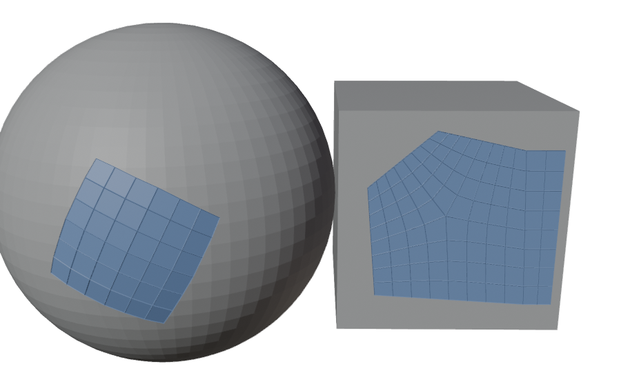
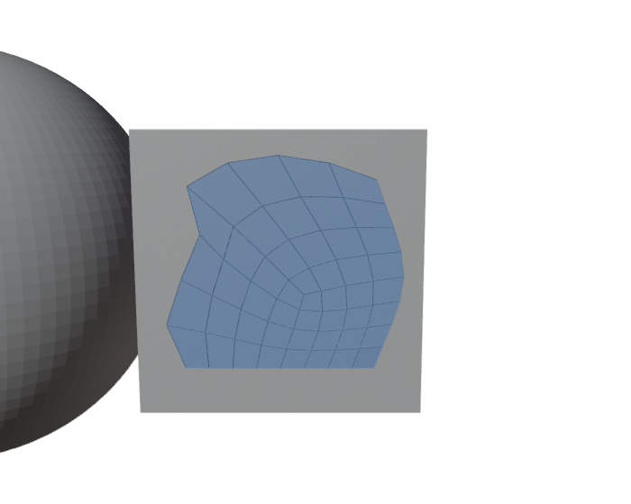
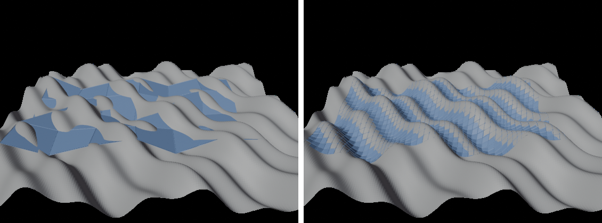

# HB_RetopoPen for Blender

Draw the outline of a patch on the surface and get a clean quad patch — retopology by drawing —
then relax and tweak it with the Retopo Brush. Patches start light (Resolution 4).

## Install (Blender 4.2+)
Edit > Preferences > Get Extensions > ⌄ (top right) > **Install from Disk…** > `hb_retopopen.zip`.

## Use
Pick **Retopo Pen** in the toolbar (Object or Edit Mode). The patches go into the mesh you're
editing, or into an object called *Retopo* (created for you, shown in front / with wireframe).

### Drawing the outline
| Action | Result |
|---|---|
| **Click** | Corner — on the surface under the mouse (any visible meshes), or on an existing retopo vertex within *Snap Radius* |
| **Shift + Click** | Curve point — the side through it becomes a smooth curve |
| **Click-drag** | Freehand — the side follows your stroke; where you let go is the next corner |
| **Click the first point** / **Enter** | Close the outline → the patch appears (dragging onto the first point closes too) |
| **Backspace** / **Ctrl+Z** | Remove the last point |
| **Esc / right-click** | Discard the outline; again to leave the pen |

### Tuning the patch (once the outline is closed)
A panel in the viewport lists everything, live:

| Key | Setting |
|---|---|
| **Wheel / + −** | Density |
| **D** | Density by *Segments* or by *Edge Length* (switching keeps the current size) |
| **L** | Layout: Auto / Grid / Centre Pole |
| **R / Shift+R** | Relax passes |
| **S / Shift+S** | Side smoothing (smooths the drawn outline) |
| **C** | Conform: *Surface* (snap onto it) / *Flat* |
| **G / Shift+G** | Conform strength |
| **F / Shift+F** | Offset above the surface |
| **P** | Projection: *Along Normal* (no sideways sliding) / *Nearest* |
| **V / Shift+V** | Edge subdivision level 0–4 (every edge split 2× … 16×, new vertices on the surface) |
| **A** | Auto subdivision: the lowest level whose edges stay within *Tolerance* of the surface |
| **T / Shift+T** | Auto tolerance (fraction of the base edge length) |
| **Click / Enter** | Keep it, then draw the next one · **Backspace**: back to the outline · **Esc**: discard |

After keeping, the redo panel (bottom-left) has all of these too, and the Tool Settings bar holds
the defaults (⚙ for the full list, plus *Snap Radius*).

## Retopo Brush — relax and tweak afterwards
The **Retopo Brush** tool (next to the pen) reshapes the retopo mesh; everything it touches stays
on the surface.

| Action | Result |
|---|---|
| **Drag** | Tweak: grab the vertices under the brush and move them with the mouse (falloff to the edge) |
| **Shift + drag** | Relax: even out the vertices under the brush |
| **[ / ]** | Brush radius · **Esc / right-click** while tweaking: cancel |

Tool Settings: mode (which one plain drag does), radius, strength, falloff, *Pin Border* (border
vertices stay put; otherwise relax slides them along the border — sharp corners always stay) and
*Front Faces Only*.

## Patch layout
- **4 corners**: a grid (each pair of opposite sides gets its own count).
  **Any other number**: one quad region per corner around a centre pole — all quads.
- **Edges follow the surface too**: *Subdivision* splits every edge (keeping the layout and its
  poles) and puts the new vertices on the surface; *Auto* picks the level that brings every edge
  within *Tolerance* of it. Left: level 0 cuts through the bumps; right: Auto (level 3).

  
- **Projection along the patch's normal** (default): points move straight onto the surface instead
  of sliding sideways off bumps into valleys (which stretches edges); it falls back to the closest
  point where that finds nothing near. *Nearest* is there for patches that wrap far around.
- **Every vertex lands on the surface**: after the patch is built and relaxed, each resulting
  vertex is projected onto the geometry underneath (with *Strength* / *Offset*), so a dense grid
  follows detail the outline didn't capture instead of clipping through it. Vertices shared with
  an existing border stay exactly where they are.
- **Neighbouring patches stitch**: a straight side drawn between two vertices of an existing open
  border reuses that border's vertices (curved or not), so patches join into one mesh.
