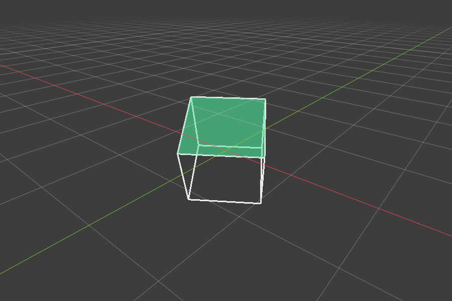
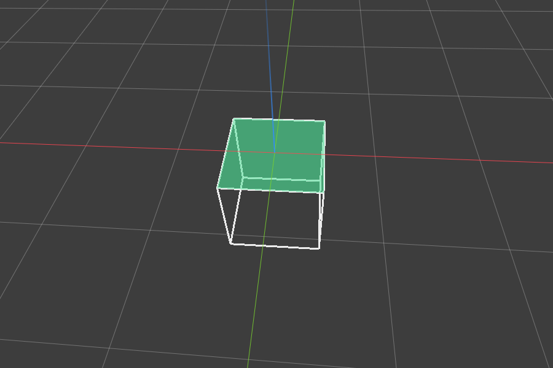

# HB_Workplane for Blender

A temporary construction plane, like Plasticity's: put the workplane on a face with
**Space**, and Move / Rotate follow it. A grid shows where the plane is.

| Automatic (world plane facing the view) | Custom (Space on the green face) |
|---|---|
|  |  |

## Install (Blender 4.2+)
Edit > Preferences > Get Extensions > ⌄ (top right) > **Install from Disk…** > `hb_workplane.zip`.

## Use
| Key | Action |
|---|---|
| **Space** | Set the workplane: from the selected face(s) in Edit Mode, otherwise from the face under the mouse. Press again on the same plane (or over empty space) to go back to automatic |
| **Alt+Space** | Back to the automatic plane |
| **G** | Move along the workplane, snapping to its grid (see below) |
| **R** | Rotate around the workplane normal |
| **E** (Edit Mode) | Extrude: vertices/edges move along the workplane; faces along the workplane normal (*Face* toggle, off by default → Blender's normal extrude) |

### Grid snapping (on by default)
While moving (G) or extruding (E) in Object Mode or Mesh Edit Mode:
- the active vertex / active object (else the selection's center) lands on grid intersections of the workplane;
  extruded faces grow in whole grid steps along the normal
- **Ctrl**: snap off while held · **X / Y**: lock to the workplane's X / Y axis · **Z**: along the normal
  (press again to unlock) · **LMB / Enter**: confirm · **RMB / Esc**: cancel
- Spacing: *Adaptive* (follows the zoom, same as the drawn grid) or *Fixed* (e.g. 10 mm);
  *Snap Subdivisions* snaps to fractions of a grid square
- With Grid Snap off, G uses Blender's own move constrained to the plane (X/Y/Z work as usual);
  other modes (curves, armatures…) always use that

- **Automatic mode** (no plane set): the world plane (XY / XZ / YZ) that faces the view is used,
  and switches as you orbit. *Ground Bias* in the sidebar controls how much the floor is preferred.
- **Selection rules** (Edit Mode): one/active face → that face; several faces → their average plane;
  3+ vertices → best-fit plane; an edge → plane through the edge facing you; a vertex → its normal.
  The plane's X axis follows the face's longest edge (or the world axis — redo panel *X Axis*).
- The redo panel (bottom-left after Space) can switch the source to **3D Cursor**, **View** or **Clear**.
- **New objects follow the workplane**: while a custom plane is set, Add (Shift+A) — objects
  and mesh primitives, also inside Edit Mode — creates them on the plane, rotated to match.
  (It parks the 3D cursor on the plane and turns on *Align: 3D Cursor*; both are restored
  when you clear the plane, unless you moved the cursor yourself. Toggle: *New Objects on Workplane*.)
- With *Set Transform Orientation* on, the workplane also becomes the transform orientation
  "HB_Workplane", so the gizmo and typed axes follow it; clearing restores the previous one.
- Sidebar (N) > **HB_Workplane**: on/off, Set / From 3D Cursor / Clear / Cursor to Workplane,
  Move/Rotate toggles, grid options (opacity, size, color, hide behind geometry).
- Preferences: rebind the shortcuts, or turn off the G/R override.

Note: Space normally plays the animation; in the 3D view it now sets the workplane
(Shift+Space or the timeline still play). Rebind in the add-on preferences if you prefer another key.

Rebuild the zip after editing: `python build_zip.py`
